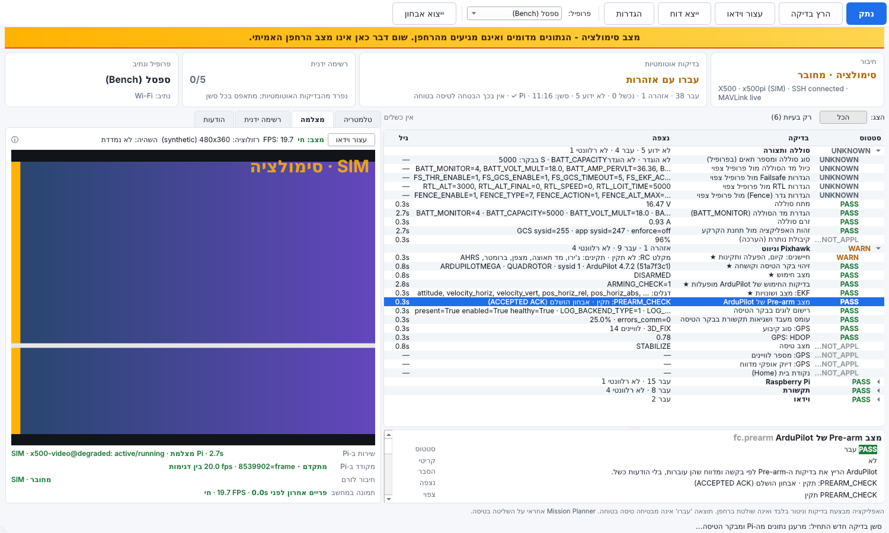

# X500 Flight Station

אפליקציית Windows בעברית לבדיקות לפני טיסה, ניטור ווידאו חי עבור רחפן **Holybro X500 V2 PNP**
(Pixhawk 6C עם ArduPilot Copter, Raspberry Pi 5, מצלמת IMX219 או מצלמת רשת USB כמו Logitech C270).

> **האפליקציה רק בודקת, מנטרת ומציגה.** היא לא מחמשת, לא ממריאה, לא משנה מצב טיסה,
> לא מפעילה מנועים, לא משנה פרמטרים ולא מכבה בדיקות Pre-arm. **Mission Planner נשאר האחראי על השליטה בטיסה.**
> תוצאה "בדיקות אוטומטיות עברו" **אינה** הבטחה לטיסה בטוחה.



---

## מה מוכן ומה נבדק

| תחום | מומש | נבדק אוטומטית (בלי חומרה) | נבדק על הרחפן האמיתי |
|---|---|---|---|
| ממשק בעברית (RTL), סימולציה, רשימה ידנית, דוחות JSON/HTML | ✔ | ✔ בדיקות GUI ב-offscreen + צילומי מסך | ✘ |
| מנוע בדיקות ופרופילים (ספסל/טיסה), כולל 10 התיקונים מסקירת קוד ה-Pi | ✔ | ✔ ‏190 בדיקות pytest | ✘ |
| SSH עם אימות מפתח שרת (host key) | ✔ | ✔ מול שרת SSH מדומה | ✘ |
| collector ב-Pi (קריאה בלבד, JSON בגרסה, קצב מהיר/איטי) | ✔ | ✔ על Linux ועל מערכת קבצים מדומה | ✘ (Pi 5 אמיתי לא נבדק) |
| MAVLink לקריאה בלבד: חיבור אחד, בחירת רחפן, סינון מקורות | ✔ | ✔ מול autopilot מדומה (MAVLink2 אמיתי), כולל רחפן שני ו-ACK מזויף | ✘ (Pixhawk 6C לא נבדק) |
| אבחון Pre-arm ‏(`MAV_CMD_RUN_PREARM_CHECKS`) עם בדיקת ACK ומקור | ✔ | ✔ ACCEPTED / נדחה / לא נתמך / בלי תשובה / חמוש | ✘ |
| וידאו SRT מהצינור הקיים ב-Pi (FFmpeg מצורף, caller) | ✔ | ✔ מקור SRT מקומי שמחקה את `x500-video-run`; ב-CI של Windows: האפליקציה **המותקנת** פענחה 31 פריימים H.264 ‏480×360 ב-SRT | ✘ (המצלמה וה-Pi לא נבדקו) |
| הפעלה/עצירה של `x500-video@<profile>` (רק `sudo -n` לשש פקודות) | ✔ | ✔ מול שרת SSH מדומה, כולל "נדרשת סיסמה" | ✘ |
| סקריפטי ה-Pi המתוקנים (`pi/x500`) ופריסה מפורשת | ✔ | ✔ עם פקודות מדומות ושורש קבצים זמני | ✘ |
| ייצוא אבחון מפורש (מוסתר, נשמר במחשב) | ✔ | ✔ | ✘ |
| חבילת Windows ‏(PyInstaller) + Setup.exe ‏(Inno Setup) | ✔ | ✔ ב-CI: התקנה שקטה + בדיקה עצמית בלי Python ([פרטים](#מצב-בנייה-ל-windows)) | ✘ מחשב Windows עם מסך |

רשימת הבדיקות המלאה, עם הספים וההצדקות: [docs/checks.md](docs/checks.md).
מה צריך לבדוק על החומרה: [docs/hardware-verification-checklist.md](docs/hardware-verification-checklist.md).

## התקנה (משתמש)

1. ב-GitHub: **Actions → Windows build (app + Setup.exe)** → הריצה האחרונה שהצליחה → הורד את
   `X500FlightStation-Setup-<גרסה>`. (לא פורסם Release - זה בכוונה.)
2. הרץ את `X500FlightStation-Setup-<גרסה>.exe`. ההתקנה היא למשתמש הנוכחי (לא צריך הרשאות מנהל)
   ואין צורך בהתקנת Python.
3. פתח את האפליקציה. כדי לראות איך היא נראית בלי רחפן: **הגדרות → כללי וסימולציה → מצב סימולציה**.
   במצב הזה יש פס כתום קבוע, הכותרת מתחילה ב-"[סימולציה]" וכל מקור נתונים מסומן `SIM`.

ההגדרות, הפרופילים, מפתחות השרת המוכרים והלוגים נשמרים ב-`%APPDATA%\X500FlightStation`.
פרטי חיבור (כתובות, שם משתמש, נתיבים) אפשר לייבא מקובץ מקומי: **הגדרות → כללי → "ייבוא הגדרות מקובץ מקומי…"**
(דוגמה: [docs/local-config.example.json](docs/local-config.example.json)). הקובץ לא נכנס למאגר ולא מכיל סיסמאות.
אותו קובץ יכול להגדיר גם בפרופיל: סוללה, ערכי פרמטרים צפויים (Failsafe, ‏RTL, גדר, מד סוללה) ובדיקות חימוש
שמותר לדלג עליהן (למשל RC כשאין שלט). הערכים הצפויים רק מושווים למה שהבקר מדווח - שום דבר לא נכתב לבקר.
הדוחות נשמרים ב-`Documents\X500FlightStation\reports`. הסרת ההתקנה לא מוחקת אותם.
סיסמאות ו-passphrase נשמרים רק במנהל האישורים של Windows.

## הפעלה ראשונה מול הרחפן

מדריך צעד-אחר-צעד: **[docs/first-bench-session.md](docs/first-bench-session.md)**.
בקצרה: מריצים את `pi/deploy/probe.sh` על ה-Pi (קריאה בלבד), ממלאים בהגדרות כתובת, משתמש ומפתח SSH,
שער מודם ה-ZTE וכתובת תחנת הקרקע, מאשרים את טביעת האצבע של מפתח השרת (משווים מול ה-Pi), ומתחברים.

## שימוש יומיומי (2-3 לחיצות)

1. **התחבר** (Ctrl+K) - אחרי החיבור האפליקציה קוראת את הפרמטרים מבקר הטיסה (קריאה בלבד)
2. **הרץ בדיקה** (F5) - מתחיל סשן חדש: מאפס את הרשימה הידנית, מרענן נתונים מה-Pi ופרמטרים מבקר הטיסה
3. (לא חובה) **הפעל וידאו** - רק כשהרחפן לא חמוש. מתחבר ב-SRT לצינור הקיים ב-Pi (פרופיל degraded כברירת מחדל).
   מצלמת USB מחוברת נבחרת אוטומטית במקום מצלמת ה-Pi ([פירוט](docs/video.md#מצלמת-usb-במקום-מצלמת-ה-pi))

אחר כך מסמנים את הרשימה הידנית אחרי בדיקה פיזית, ו**ייצא דוח** (Ctrl+S) שומר JSON ו-HTML.
ה"בדיקות האוטומטיות" וה"רשימה הידנית" מוצגות בנפרד. כל בדיקה מציגה סטטוס
(PASS / WARN / FAIL / UNKNOWN / NOT_APPLICABLE), הסבר, ערך נצפה, תנאי צפוי, מקור הנתון וגיל התצפית.

## עקרונות בטיחות (מה האפליקציה לעולם לא עושה)

- **לא שולחת HEARTBEAT**, ‏RC_CHANNELS_OVERRIDE או MANUAL_CONTROL. אלה ההודעות היחידות שמאפסות את טיימר
  ה-GCS failsafe ב-ArduPilot, ולכן היא לא יכולה "להחזיק" את הקישור במקום Mission Planner או להסתיר ניתוק שלו.
- משתמשת ב-sysid/compid משלה (‏247/25, ניתן לשינוי), שונה מתחנת הקרקע.
- שולחת רק `PARAM_REQUEST_READ`, ‏`MAV_CMD_REQUEST_MESSAGE` (בקשה חד-פעמית שלא משנה קצבי שידור ולא כותבת פרמטרים),
  ו-`MAV_CMD_RUN_PREARM_CHECKS` - רק בלחיצה על "הרץ בדיקה" וכשהרחפן מאושר כלא חמוש. היא לעולם לא מנסה לחמש כדי לבדוק מוכנות.
  כל הודעה אחרת נחסמת בקוד ונבדקת בבדיקות. אפשר לכבות גם את זה (מצב האזנה בלבד).
- לא פותחת את הפורט הטורי של ה-Pixhawk. מתחברת ל-endpoint קיים של mavlink-router (ברירת מחדל: מנהרת SSH ל-`127.0.0.1:5760` על ה-Pi).
- חיבור או הרצת בדיקה לא מתקינים כלום ב-Pi ולא משנים בו דבר: ה-collector נשלח ב-SSH ל-`python3 -` ורץ בקריאה בלבד.
  פריסת הסקריפטים המתוקנים (`deploy_x500.sh`) היא שלב נפרד שאתה מריץ ידנית, עם הרצה יבשה וגיבוי.
- הפעולות היחידות שמשנות משהו ב-Pi: הפעלה/עצירה מפורשת של שירות הווידאו (`x500-video@high|normal|degraded`), רק כשהרחפן לא חמוש,
  והפעלה מחדש מפורשת של mavlink-router - רק כש-systemd מדווח שהוא נפל (‏failed/inactive), אחרי אישור בחלון ([פירוט](docs/mavlink-safety.md#הפעלה-מחדש-של-mavlink-router)).
  האפליקציה לא מקלידה סיסמת sudo ולא דורשת sudo רחב.
- דוחות וייצוא אבחון: סיסמאות ומפתחות מוסרים תמיד. כתובות IP, ‏MAC, מספר סידורי של ה-Pixhawk, שם המשתמש ושם רשת ה-Wi-Fi מוסתרים כברירת מחדל.
- מפתח שרת SSH לא מוכר לעולם לא מתקבל בשקט. מפתח שהשתנה נחסם.
- נתון חסר, ישן, לא נתמך או פגום לעולם לא מוצג כ-PASS. בדיקה קריטית שלא הוגדרה מונעת תוצאה "עברו".

פירוט: [docs/mavlink-safety.md](docs/mavlink-safety.md).

## פיתוח

דרוש Python 3.12.

```bash
python -m venv .venv
.venv\Scripts\activate            # Linux: source .venv/bin/activate
pip install --require-hashes -r requirements.txt -r requirements-dev.txt
set PYTHONPATH=src                # Linux: export PYTHONPATH=src
python -m x500fs                  # הפעלת האפליקציה
python -m pytest -q               # כל הבדיקות
```

- autopilot מדומה (MAVLink2 אמיתי על TCP): `python -m x500fs.sim.mock_mavlink --port 5760`,
  ואז בהגדרות MAVLink: "TCP ישיר" אל `127.0.0.1:5760`.
- מקור וידאו SRT מדומה (כמו `x500-video-run`): `python -m x500fs.video.testsource --port 5600 --profile degraded`,
  ואז בהגדרות וידאו: כתובת SRT ‏`127.0.0.1`, ולבטל "הפעל/עצור את x500-video ב-Pi".
  ב-Linux צריך FFmpeg של המערכת עם libsrt (ה-build המצורף ל-Linux לא פותח קלטי רשת; ב-Windows אין בעיה).
- חבילת פריסה ל-Pi: `python tools/make_pi_bundle.py` → ‏`dist/x500-pi-bundle-<גרסה>.tar.gz`
- בדיקה עצמית (כמו ב-CI): `python -m x500fs --self-test result.json --offscreen`
- צילומי מסך לתיעוד: `python tools/screenshots.py docs/screenshots`
- עדכון קטלוג הבדיקות: `python tools/gen_checks_doc.py`
- עדכון תלויות: ערוך את `requirements.in` ואז
  `uv pip compile requirements.in --universal --python-version 3.12 --generate-hashes -o requirements.txt`

ארכיטקטורה: [docs/architecture.md](docs/architecture.md).

## בנייה ל-Windows

```bat
python -m PyInstaller --noconfirm --clean packaging\x500fs.spec
"C:\Program Files (x86)\Inno Setup 6\ISCC.exe" /DAppVersion=0.1.0 packaging\installer.iss
```

התוצאה: `dist\X500FlightStation\` (תיקייה ניידת) ו-`packaging\Output\X500FlightStation-Setup-0.1.0.exe`.

### מצב בנייה ל-Windows

ה-workflow ‏`.github/workflows/windows-build.yml` מריץ על `windows-latest`: בדיקות pytest, בניית PyInstaller,
בדיקה עצמית של החבילה, בניית Setup.exe, **התקנה שקטה והרצת הבדיקה העצמית של האפליקציה המותקנת כשאף Python לא נמצא ב-PATH**,
והסרה שקטה שמוודאת שנתוני המשתמש נשארים. התוצרים: Setup.exe, ‏zip נייד ותוצאות הבדיקה העצמית.
**נבדק בפועל ב-CI** (Windows Server 2025, ‏`windows-latest`, ריצה מ-14.10.2026): כל הבדיקות עברו (בדיקות שדורשות shell של POSIX
רצות רק ב-Linux CI), ‏FFmpeg המצורף הוא `7.1-essentials_build-www.gyan.dev` עם פרוטוקול `srt`, ‏Setup.exe נבנה (‏~59MB),
הותקן בשקט, והאפליקציה **המותקנת** עברה את כל שלבי הבדיקה העצמית **כש-Python הוסר מה-PATH**: ממשק בסימולציה + דוח,
MAVLink מול autopilot מדומה, פענוח H.264 מקובץ, **פענוח SRT מקצה לקצה (31 פריימים, 480×360, ‏H.264, ‏20 FPS)**, קבצי ה-Pi
ומנהל האישורים. ההסרה מחקה את קבצי האפליקציה והשאירה את `%APPDATA%\X500FlightStation`.
**לא נבדק:** הפעלה על מחשב Windows אמיתי עם מסך (ב-CI הממשק רץ במצב offscreen), מראה הגופן העברי, וזרם SRT מה-Pi האמיתי.

## צד ה-Pi

- [pi/README.md](pi/README.md): ‏`probe.sh` (קריאה בלבד) ומה ה-collector קורא.
- [pi/x500/README.md](pi/x500/README.md): הגרסאות המתוקנות של `x500-preflight`, ‏`x500-health`, ‏`x500-status`, הקופסה השחורה
  וכלי הרשת, שמשתמשות באותן בדיקות כמו האפליקציה, ופריסה מפורשת (`deploy_x500.sh`: הרצה יבשה, diff, גיבוי, `--apply`).
- [docs/pi-integration-plan.md](docs/pi-integration-plan.md): איך קוד ה-Pi הקיים שולב ומה תוקן.

## מסמכים

- [docs/first-bench-session.md](docs/first-bench-session.md) - מפגש ספסל ראשון
- [docs/hardware-verification-checklist.md](docs/hardware-verification-checklist.md) - מה עוד לא אומת על החומרה
- [docs/checks.md](docs/checks.md) - כל הבדיקות, הספים וההצדקות
- [docs/video.md](docs/video.md) - וידאו SRT מהצינור הקיים, ארבעת המחוונים, sudo מצומצם, מדידת ביצועים
- [docs/pi-integration-plan.md](docs/pi-integration-plan.md) - שילוב קוד ה-Pi הקיים ו-10 התיקונים
- [docs/mavlink-safety.md](docs/mavlink-safety.md) - למה האפליקציה לא יכולה להשפיע על הטיסה
- [docs/architecture.md](docs/architecture.md) - מבנה הקוד
- [docs/THIRD_PARTY_NOTICES.md](docs/THIRD_PARTY_NOTICES.md) - רישיונות של רכיבים מצורפים
